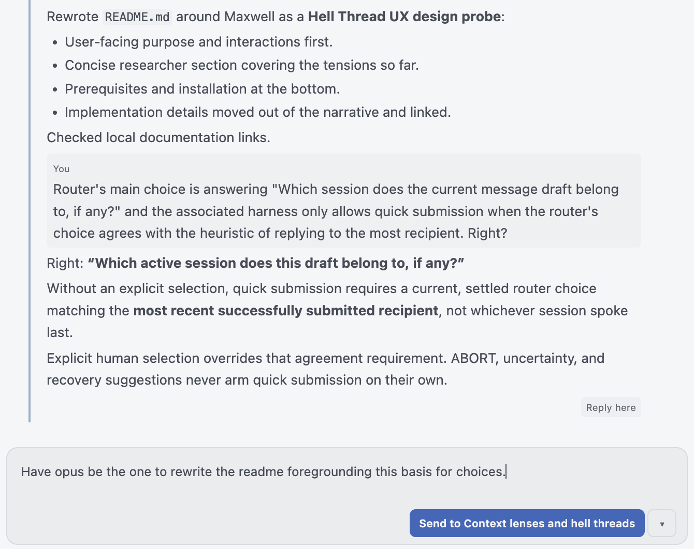

# Maxwell

**A Hell Thread UX design probe for OpenChamber.**

Curious about the "hell thread" interface associated with Meta Muse and OpenAI
Dots? Maxwell lets you try one with your own OpenChamber sessions: read several
conversations in one stream, write in one composer, and let a model weigh in on
where each message belongs.

The sessions stay separate. Maxwell merges your view, not their histories, and
each remains usable in OpenChamber without it.


*AI-generated illustration of message routing can problematically shape message semantics.*

## Why Maxwell?

In the thought experiment [Maxwell's demon](https://en.wikipedia.org/wiki/Maxwell%27s_demon),
a little demon sorts fast and slow molecules by opening and closing a gate at
just the right moments, separating what would otherwise be thoroughly mixed.

Our little demon, Maxwell, sorts messages instead. He watches the draft and
opens the quick-send gate when the router and recency heuristic agree, keeping
it closed when they don't. You still choose when to send and can explicitly
select a destination to override him.

## Why routing matters

Your sessions already hold ambient authority: credentials, tool access, and
standing instructions to act. In a merged composer, the recipient determines
what a message means and what it does. "lgtm" can approve a paragraph in one
session and a destructive operation in another.

Maxwell probes that inherent risk. It does not claim to make a hell thread safe,
and adding visibility to the interface does not remove the ambiguity.

## How a message finds its recipient

Maxwell's model-based router answers one question:

> **Which active session does the current message draft belong to, if any?**

It considers every active session independently, without bias toward your last
recipient or your current selection.

Separately, the harness keeps a recency heuristic: the most recent
*successfully submitted* recipient, not whichever session spoke last. The send
button names that recipient.

- **Quick submission.** With no explicit selection, Enter or Send works only when
  the current, settled router recommendation for this exact draft agrees with
  the recency heuristic. Otherwise Maxwell asks you to choose.



*Agreement: router and recency heuristic name the same session, so the
composer stays quiet and Enter sends.*

- **Explicit selection.** The destination dropdown, `Ctrl+number`, or **Reply
  here** selects without sending. On submission your choice overrides the
  model's advice.
- **Pushback.** The router can still disagree after you select. Its explanation
  is advisory, not a veto.


*Pushback: you chose Tomorrow's lecture plans, the router recommends Context
lenses and hell threads, and sending stays available.*

- **ABORT.** A confident ABORT ("pause before sending this draft as written")
  is distinct from uncertainty. A second discrete choice may then recommend
  revising the draft or rerouting it to a specific session. That advice never
  arms submission by itself.

Routing guidance you save under **Sessions → Guidance** stays in Maxwell and is
never appended to a session. The trusted inference calls do receive it alongside
draft and session excerpts. The router never edits your messages.

See [dispatch intent](docs/dispatch-intent.md) and
[routing recovery](docs/routing-recovery.md) for the full contract.

## Professional driver, closed course

This is a working prototype, not a safe way to consolidate sensitive work. A
closed course means actually bounded resources: synthetic data and sessions
whose tools and credentials cannot damage anything real. A warning does not
create that containment.

Project scope is only a fallible privacy proxy. One course root can hold public
course material using many inference providers alongside confidential student
data. Use at your own risk.

## For UX researchers

Tensions encountered so far:

- **Speed versus deliberation.** Speed motivates reaching for the merged composer and makes
  recipient mistakes harder to catch. Overrides preserve agency without
  guaranteeing informed consent.
- **Separate histories, shared attention.** Provider contexts stay apart, but
  the human interprets every thread in one stream, and a short acknowledgment
  can lose its referent.
- **Missing operational visibility.** The prototype omits reasoning, tool
  traffic, delegation, and context-window usage. Restoring them would not
  alone resolve the composer's ambiguity.
- **Projects are not privacy boundaries.** A shared filesystem root can conceal
  different disclosure requirements.
- **A trusted router crosses domains.** To advise about boundaries, its provider
  sees drafts, excerpts, and guidance spanning all of them.

These are observations, not user-study findings. See
[verification notes](docs/verification.md).

## Prerequisites and installation

- OpenChamber **2.5.0+**, desktop or web, with OpenCode V2 sessions. Extension
  Pages are not available on mobile.
- An OpenChamber origin and dedicated client token. That token grants broad host
  access; selecting a few sessions in Maxwell does not narrow it.
- Tinfoil access to **`decision-large`** (routing) and **`deepseek-v4-1-flash`**
  (explanations and management). Maxwell verifies Tinfoil attestation and has no
  fallback provider. Using your own trusted provider or models requires code
  changes, not just a different API key.
- Node.js **22.18+**.

Clone this repository, then run inside the project folder:

```sh
npm ci
npm run build
```

In **Settings → Extensions → Add**, choose the built project folder on disk
and approve its capabilities. Keep that folder in place: OpenChamber runs the
extension from it. Open the Maxwell Page and
enter your host connection and Tinfoil key-file location in its connection
settings. OpenChamber starts the service automatically.

Details: [host connection](docs/backend.md),
[trusted inference](docs/tinfoil.md), [integration notes](docs/integration.md).

For a synthetic preview without host access or inference:

```sh
npm run dev
# Open http://127.0.0.1:4318/?demo=1
```

When modifying Maxwell, run `npm run check` and `npm test` before rebuilding.
Reload the Page after rebuilding; service changes also require pausing and
resuming the extension in Settings.
